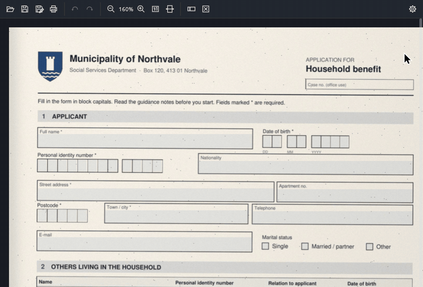
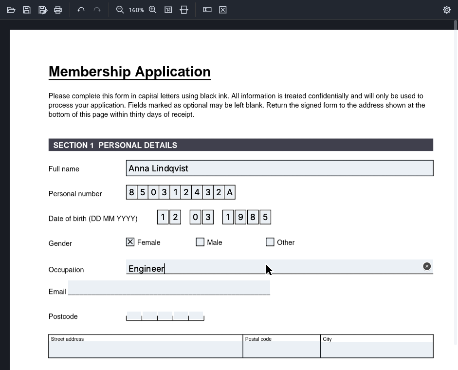
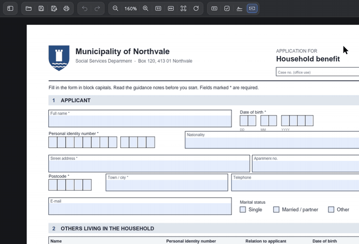
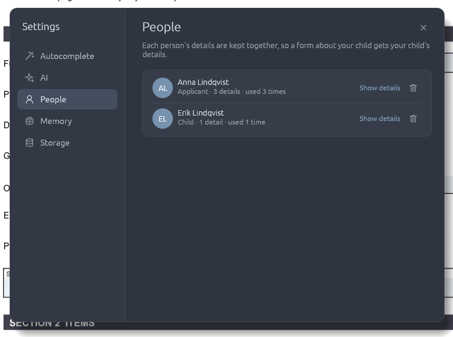

<p align="center">
  
</p>

<h1 align="center">pdfr</h1>

<p align="center"><b>Fill in PDF forms the way they were meant to be filled in.</b></p>

pdfr is a fast, friendly PDF viewer for filling in forms: tax forms, school
applications, permits, anything with boxes to fill. Click a box, type, and
your text lands neatly inside it at the right size. That's it.

Free for personal use. **Made for Linux**: every distribution, every desktop,
and right at home on [Omarchy](https://omarchy.org). macOS and Windows are
on the way.

<p align="center">
  
  <br>
  <sub>Click and type. <a href="docs/media/fill.mp4">Watch in higher quality</a></sub>
</p>

---

## Why pdfr?

### Forms that actually work

You know the struggle: a form that's just lines and boxes, so you end up
dragging text boxes around, guessing the font size, or tapping the space bar
to line letters up with little squares.

pdfr fixes that.

- **Click and type.** Your text appears exactly where you clicked, inside the
  box, at a size that fits.
- **One letter per square.** Rows of little boxes (dates, ID numbers, postcodes)
  get one character per box, automatically. When a row is full, typing carries
  on in the next one.
- **Every kind of form.** It works with PDFs that have proper fill-in fields,
  with forms that are only drawn on the page, and even with scanned paper forms.
  pdfr finds the boxes and lines for you.
- **What you see is what you get.** The saved and printed form looks just like
  the screen, and other PDF apps can still open and edit it.

<p align="center">
  
</p>

### Fast

pdfr opens straight away. The first page is on screen in about a tenth of a
second, even for a 300-page document, and scrolling stays smooth with no blank
pages.

### Made for Linux

pdfr runs on any Linux distribution and desktop: GNOME, KDE Plasma, Cosmic,
XFCE, Cinnamon, Hyprland, Sway and the rest, on Wayland or X11. It follows
your desktop's light or dark mode, uses its own file and print dialogs, and
shows up in your app launcher and under "Open with". On Omarchy it even
takes on your theme and switches live when you change it.

### Remembers you, privately

pdfr can remember the details you type (names, addresses, ID numbers, e-mail)
and offer them on the next form, in any language.

- **Each person stays separate.** Your details, your partner's and your
  kids' are kept apart, so a form about your child gets your child's details,
  not yours.
- **You decide.** After you save, pdfr shows what it would like to remember,
  and you pick. Or tell it to always or never remember.
- **It stays on your computer.** Nothing is uploaded. Passwords and card
  numbers are never stored.

<p align="center">
  
  <br>
  <sub>Suggestions, person by person. <a href="docs/media/remember.mp4">Watch in higher quality</a></sub>
</p>

---

## How it compares

pdfr does one thing, filling in forms, and aims to do it better than anyone.
The big PDF editors do a lot more. Here's an honest side-by-side.

### Filling in forms

|  | pdfr | Acrobat | Foxit | PDF-XChange |
|---|:---:|:---:|:---:|:---:|
| Fillable PDF forms | ✅ | ✅ | ✅ | ✅ |
| Print | ✅ | ✅ | ✅ | ✅ |
| Finds the boxes on any form, by itself | ✅ | ➖ | ➖ | ➖ |
| Scanned paper forms | ✅ | ➖ | ➖ | ➖ |
| One letter per square, automatically | ✅ | ➖ | ➖ | ➖ |
| Remembers each person separately | ✅ | ❌ | ❌ | ❌ |
| Linux | ✅ | ❌ | ❌ | ❌ |
| macOS | 🔜 | ✅ | ✅ | ❌ |
| Windows | 🔜 | ✅ | ✅ | ✅ |
| Price | Free¹ | $20/mo | $11/mo | One-time² |

### Everything else

|  | pdfr | Acrobat | Foxit | PDF-XChange |
|---|:---:|:---:|:---:|:---:|
| Edit text and images | 🔜 | ✅ | ✅ | ✅ |
| Read text in scans (OCR) | 🔜 | ✅ | ✅ | ✅ |
| Comments and highlights | 🔜 | ✅ | ✅ | ✅ |
| Digital signatures | 🔜 | ✅ | ✅ | ✅ |
| Merge and reorder pages | 🔜 | ✅ | ✅ | ✅ |

✅ Yes &nbsp;·&nbsp; ➖ Possible, but you set it up yourself (often a paid
extra) &nbsp;·&nbsp; ❌ No &nbsp;·&nbsp; 🔜 Not yet

¹ For personal use. ² Free version available. Acrobat Reader is free for
filling in fillable forms.

<sub>Based on each company's public information and reviews, November 2026.
Prices are approximate, in US dollars.
[Spotted a mistake?](https://github.com/kjellberg/pdfr/issues)</sub>

---

## Install

**Arch, Omarchy, Manjaro, EndeavourOS** (AUR)

```sh
yay -S pdfr-bin
```

**Debian, Ubuntu, Linux Mint, Pop!_OS**

```sh
curl -fsSL https://kjellberg.github.io/packages/pdfr.gpg | sudo tee /usr/share/keyrings/pdfr.gpg >/dev/null
echo "deb [signed-by=/usr/share/keyrings/pdfr.gpg] https://kjellberg.github.io/packages/deb stable main" | sudo tee /etc/apt/sources.list.d/pdfr.list
sudo apt update && sudo apt install pdfr
```

**Fedora, RHEL, AlmaLinux, Rocky**

```sh
sudo dnf config-manager addrepo --from-repofile=https://kjellberg.github.io/packages/rpm/pdfr.repo
sudo dnf install pdfr
```

**openSUSE**

```sh
sudo zypper addrepo https://kjellberg.github.io/packages/rpm/pdfr.repo
sudo zypper install pdfr
```

**Flatpak** (any distribution, including Silverblue, Bazzite and SteamOS):
coming to Flathub.

**Any other Linux**

Download `pdfr-…-linux.tar.gz` from the
[releases page](https://github.com/kjellberg/pdfr/releases), unpack it, and run
`./pdfr --register` to add pdfr to your app menu, "Open with" and the
terminal (no root needed).

Updates arrive with your normal system updates.

**Make pdfr your PDF app:** pdfr offers this the first time you start it.
You can also turn it on later in **Settings → General**.

---

## Filling in a form

1. **Open a PDF:** drag it onto the window, press **Ctrl+O**, or run
   `pdfr form.pdf`.
2. **Click a box and type.** Press **Tab** to jump to the next box.
3. **Save:** press **Ctrl+S**. pdfr never overwrites your original file without
   asking. The first time, it suggests a new name like `form-filled.pdf`.
4. **Print:** press **Ctrl+P**.

### Handy tricks

- **Suggestions:** in an empty box, pdfr may show a grey suggestion. Press
  **Tab** to take it. Press **↑** or **↓** to look through other suggestions.
- **Hover buttons:** hover over a box to get a small button: **✕** clears it,
  **✨** shows suggestions.
- **Missed a box?** Use the toolbar to add a text box (drag) or a checkbox
  (click) yourself. Right-click a box pdfr added by mistake to remove it.
- **Undo anything** with **Ctrl+Z**.

### Keyboard shortcuts

| What | Keys |
|---|---|
| Open, save, save as, print | Ctrl+O, Ctrl+S, Ctrl+Shift+S, Ctrl+P |
| Next / previous box | Tab / Shift+Tab |
| Tick a checkbox | Space or click |
| Take the suggestion | Tab |
| Browse suggestions | ↑ / ↓ |
| Leave a box | Esc |
| Undo / redo | Ctrl+Z / Ctrl+Shift+Z |
| Zoom in / out / 100% | Ctrl+= / Ctrl+− / Ctrl+0 (or Ctrl+scroll) |

---

## Your data stays yours

- Everything pdfr remembers is kept in one file on your computer that only you
  can read. Look through it, or delete people and values, any time in
  **Settings**.

  
- **Optional AI helper.** If you have
  [Claude Code](https://claude.com/claude-code) installed, pdfr can ask it what
  an unusual box label means, or which boxes belong to which person on a
  family form. It only ever sends the printed labels and headings, **never what
  you type**. pdfr asks before using it the first time, and you can switch it
  off in Settings. Without it, everything else works just the same.

---

## Not there yet

- Suggestions on scanned forms only work for forms you've filled in before
  (pdfr doesn't read scanned text yet).
- Password-protected PDFs, signature fields and some unusual form types.
- Alphabets beyond Latin, Greek and Cyrillic (for example Chinese or Arabic).

Found a bug or a form that doesn't work?
[Open an issue](https://github.com/kjellberg/pdfr/issues). A sample PDF helps a lot
(a blank form, never one with your personal details).

---

## Free for personal use

pdfr is **free for personal and non-commercial use**, and for schools,
charities and public institutions.

The source code is public: you're welcome to read it, learn from it, and
[contribute](CONTRIBUTING.md). It isn't "open source" in the strict sense,
though: you may not copy, redistribute, sell, or publish changed versions of
pdfr.

Want to use pdfr in your business? Paid licences are planned. Get in touch
through the [project page](https://github.com/kjellberg/pdfr).

The full terms are in [LICENSE.md](LICENSE.md) (PolyForm Strict 1.0.0).

---

## Thanks

pdfr types your text in [Inter](https://rsms.me/inter/) (SIL Open
Font License) and is built on many excellent open-source Rust libraries, each
under its own licence.
