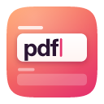
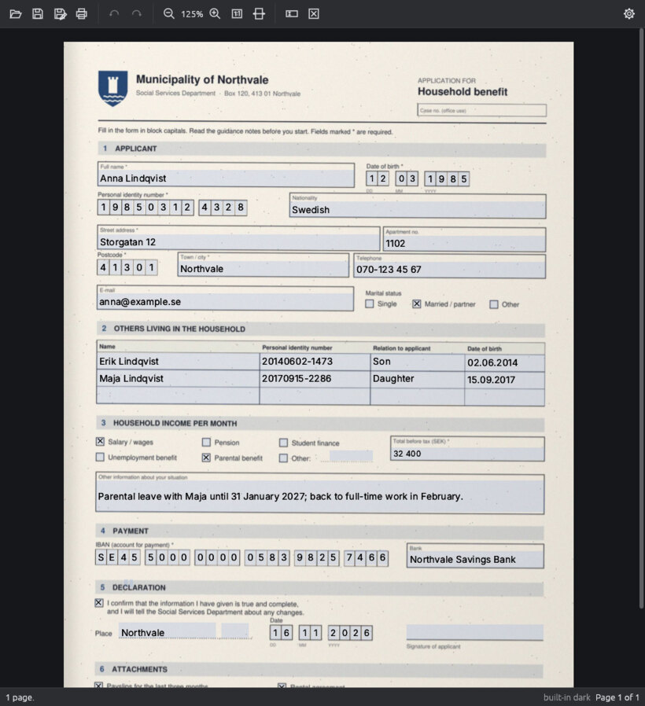
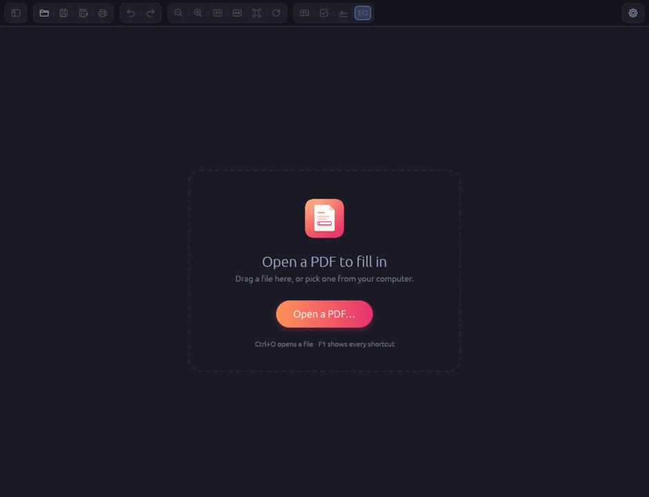
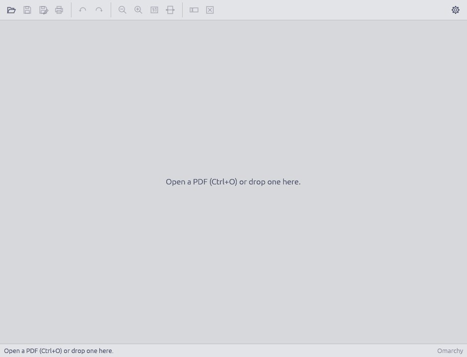
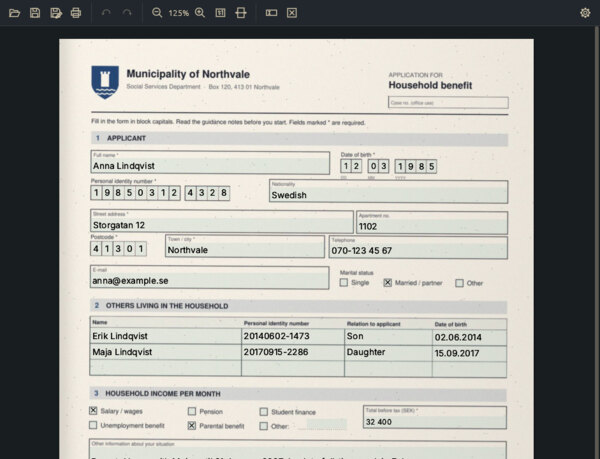
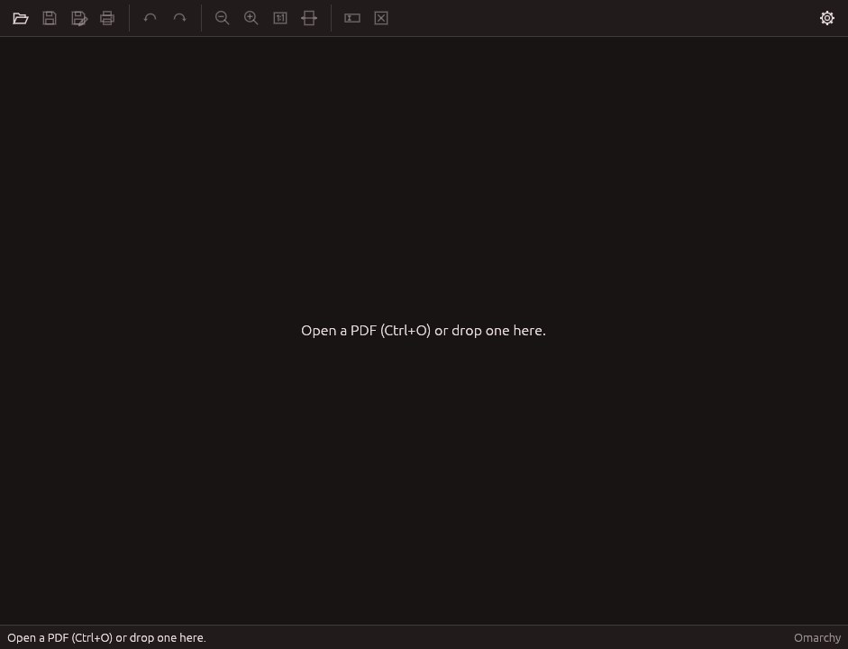

<p align="center">
  
</p>

<h1 align="center">pdfr</h1>

<p align="center"><b>Fill in PDF forms the way they were meant to be filled in.</b></p>

<p align="center"><a href="https://pdfr.app"><b>pdfr.app</b></a> · <a href="#install">Install</a> · <a href="https://github.com/kjellberg/pdfr/releases">Releases</a></p>

<p align="center">
  <a href="https://github.com/kjellberg/pdfr/actions/workflows/ci.yml"></a>
  <a href="https://github.com/kjellberg/pdfr/releases"></a>
  
  <a href="https://omarchy.org"></a>
  
  <a href="LICENSE.md"></a>
</p>

pdfr is a fast, friendly PDF viewer for filling in forms: tax forms, school
applications, permits, anything with boxes to fill. Click a box, type, and
your text lands neatly inside it at the right size. That's it.

Free for personal use. **Born on [Omarchy](https://omarchy.org), fits every
distro**: any distribution, any desktop. Now on macOS too; Windows is on the way.
See it in action and install it at **[pdfr.app](https://pdfr.app)**.

<p align="center">
  
  <br>
  <sub>Click and type, even on a scanned paper form. <a href="docs/media/fill.mp4">Watch in higher quality</a></sub>
</p>

---

## Why pdfr?

### Forms that actually work

You know the struggle: a form that's just lines and boxes, so you end up
dragging text boxes around, guessing the font size, or tapping the space bar
to line letters up with little squares.

pdfr fixes that.

- **Click and type.** Your text appears exactly where you clicked, inside the
  box, at a size that fits.
- **One letter per square.** Rows of little boxes (dates, ID numbers, postcodes)
  get one character per box, automatically. When a row is full, typing carries
  on in the next one.
- **Every kind of form.** It works with PDFs that have proper fill-in fields,
  with forms that are only drawn on the page, and even with scanned paper forms.
  pdfr finds the boxes and lines for you.
- **What you see is what you get.** The saved and printed form looks just like
  the screen, and other PDF apps can still open and edit it.

<p align="center">
  
  <br>
  <sub>A scanned paper form (slightly crooked, grainy) filled in with pdfr. Every box was found automatically.</sub>
</p>

### Fast

pdfr opens straight away. The first page is on screen in about a tenth of a
second, even for a 300-page document, and scrolling stays smooth with no blank
pages.

### Fits every distro

pdfr runs on any Linux distribution and desktop: GNOME, KDE Plasma, Cosmic,
XFCE, Cinnamon, Hyprland, Sway and the rest, on Wayland or X11. It follows
your desktop's light or dark mode, uses its own file and print dialogs, and
shows up in your app launcher and under "Open with".

### Born on Omarchy

pdfr was born on [Omarchy](https://omarchy.org). It takes on your Omarchy
theme, toolbar, highlights and all, and switches the moment you change
themes. It opens from Super+Space, and it feels like it came with the system.

<table>
  <tr>
    <td></td>
    <td></td>
  </tr>
  <tr>
    <td align="center"><sub>Tokyo Night</sub></td>
    <td align="center"><sub>Catppuccin Latte</sub></td>
  </tr>
  <tr>
    <td></td>
    <td></td>
  </tr>
  <tr>
    <td align="center"><sub>Everforest</sub></td>
    <td align="center"><sub>Ristretto</sub></td>
  </tr>
</table>

### Remembers you, privately

pdfr can remember the details you type (names, addresses, ID numbers, e-mail)
and offer them on the next form, in any language.

- **Each person stays separate.** Your details, your partner's and your
  kids' are kept apart, so a form about your child gets your child's details,
  not yours.
- **You decide.** After you save, pdfr shows what it would like to remember,
  and you pick. Or tell it to always or never remember.
- **It stays on your computer.** Nothing is uploaded. Passwords and card
  numbers are never stored.

<p align="center">
  
  <br>
  <sub>Suggestions, person by person. <a href="docs/media/remember.mp4">Watch in higher quality</a></sub>
</p>

### Works with your AI agent

Hand the form to Claude (or Cursor, or any agent that speaks MCP) and watch
it get filled in. Connect it once:

```sh
claude mcp add pdfr -- pdfr mcp
```

Then ask: *"Fill in ~/Downloads/application.pdf with my details and save it
next to the original."* The agent opens pdfr, reads the boxes, fills them in
and saves, in a window on your screen.

- **It sees what you see.** The agent can read every box by its label, or
  look at the window and use the pointer and keyboard like a person.
- **You stay in charge.** Click or type and the agent pauses. Signing
  digitally and saving over an existing file ask you first.
- **Local.** The agent talks to pdfr on your computer only. What it may do
  is yours to set in **Settings → AI agents**, where the line for other
  agents is ready to copy.

### Sign it, check it, pass it on

- **Sign without a printer.** Draw or type your signature, or use a photo of
  it (**Ctrl+I**). Or sign digitally with your ID card, a USB token, a
  certificate in your browser or the macOS Keychain, or a .p12 file: the
  Certificate tab of the same dialog (**Ctrl+Shift+C**). Signatures carry a
  trusted timestamp and the proof needed to check them for years (PAdES B-LTA).
- **Checks signatures** on the PDFs you receive: who signed, when, whether the
  document changed since, and whether the certificate was revoked.
- **Check before you send** (**Ctrl+Shift+E**): answers that look wrong (an
  e-mail without @, an IBAN or ID number with a wrong digit) and boxes still
  empty. Saving asks first.

### More than forms

- **Reads scanned pages** on your computer, so scans can be searched and
  copied, and their boxes get labels and suggestions.
- **Comments and markup:** notes, highlights, underline and strike-through,
  text boxes and shapes, saved as standard PDF comments.
- **Organise pages:** drag thumbnails to move pages; delete, extract, turn,
  insert blank pages, merge another PDF or add a photo as a page.
- **Redact for real:** text, pictures and fields under the black boxes are
  removed from the file, not just covered.

---

## How it compares

pdfr does one thing, filling in forms, and aims to do it better than anyone.
The big PDF editors do a lot more. Here's an honest side-by-side.

### Filling in forms

|  | pdfr | Acrobat | Foxit | PDF-XChange |
|---|:---:|:---:|:---:|:---:|
| Fillable PDF forms | ✅ | ✅ | ✅ | ✅ |
| Print | ✅ | ✅ | ✅ | ✅ |
| Finds the boxes on any form, by itself | ✅ | ➖ | ➖ | ➖ |
| Scanned paper forms | ✅ | ➖ | ➖ | ➖ |
| One letter per square, automatically | ✅ | ➖ | ➖ | ➖ |
| Sign with a drawn or typed signature | ✅ | ✅ | ✅ | ✅ |
| Digital signatures (ID card, token, certificate) | ✅ | ✅ | ✅ | ✅ |
| Remembers each person separately | ✅ | ❌ | ❌ | ❌ |
| Linux | ✅ | ❌ | ❌ | ❌ |
| macOS | ✅ | ✅ | ✅ | ❌ |
| Windows | 🔜 | ✅ | ✅ | ✅ |
| Price | Free¹ | $20/mo | $11/mo | One-time² |

### Everything else

|  | pdfr | Acrobat | Foxit | PDF-XChange |
|---|:---:|:---:|:---:|:---:|
| Read text in scans (OCR) | ✅ | ✅ | ✅ | ✅ |
| Comments and highlights | ✅ | ✅ | ✅ | ✅ |
| Merge and reorder pages | ✅ | ✅ | ✅ | ✅ |
| Redaction | ✅ | ✅ | ✅ | ✅ |
| Edit the PDF's own text and images | 🔜 | ✅ | ✅ | ✅ |

✅ Yes &nbsp;·&nbsp; ➖ Possible, but you set it up yourself (often a paid
extra) &nbsp;·&nbsp; ❌ No &nbsp;·&nbsp; 🔜 Not yet

¹ For personal use. ² Free version available. Acrobat Reader is free for
filling in fillable forms.

<sub>Based on each company's public information and reviews, November 2026.
Prices are approximate, in US dollars.
[Spotted a mistake?](https://github.com/kjellberg/pdfr/issues)</sub>

---

## Install

On **Linux** (any distribution, x86_64 or ARM) and **macOS** (Apple silicon
or Intel, macOS 12 or newer), in a terminal:

```sh
curl -fsSL https://pdfr.app/install.sh | sh
```

**Run the same line again to update.** No root needed. On Linux, pdfr goes in
`~/.local/share/pdfr` and adds itself to your app menu, "Open with" and the
terminal. On macOS it goes in Applications. pdfr can also tell you when a new
version is out (it asks first), with the line to run.

To remove it: `curl -fsSL https://pdfr.app/install.sh | sh -s -- --uninstall`

Rather download it yourself? The
[releases page](https://github.com/kjellberg/pdfr/releases/latest) has the
`.dmg` for macOS (it isn't notarized yet, so the first time, click **Done**,
then **System Settings → Privacy & Security → Open Anyway**), the `.tar.gz`
for any Linux (`./pdfr --register` adds it to your app menu), and `.deb` and
`.rpm` packages.

**Make pdfr your PDF app:** pdfr offers this the first time you start it.
You can also turn it on later in **Settings → General**.

---

## Filling in a form

1. **Open a PDF:** drag it onto the window, press **Ctrl+O**, or run
   `pdfr form.pdf`.
2. **Click a box and type.** Press **Tab** to jump to the next box.
3. **Sign:** press **Ctrl+I**, draw or type your signature, and click where
   it goes. pdfr can keep it for next time.
4. **Save:** press **Ctrl+S**. pdfr never overwrites your original file without
   asking. The first time, it suggests a new name like `form-filled.pdf`.
5. **Print:** press **Ctrl+P**.

### Handy tricks

- **Suggestions:** in an empty box, pdfr may show a grey suggestion. Press
  **Tab** to take it. Press **↑** or **↓** to look through other suggestions.
- **Hover buttons:** hover over a box to get a small button: **✕** clears it,
  **✨** shows suggestions.
- **Missed a box?** Use the toolbar to add a text box (drag) or a checkbox
  (click) yourself. Right-click a box pdfr added by mistake to remove it.
- **Copy text from the PDF:** drag over it (or double-click a word), then
  press **Ctrl+C**. Select text to highlight or comment on it too.
- **Already filled in by another app?** Right-click the printed answer and
  choose **Edit this text** to type over it.
- **Pages:** right-click a thumbnail in the sidebar (**Ctrl+B**) to delete,
  extract or insert pages, or drag it to move the page.
- **Undo anything** with **Ctrl+Z**.

### Keyboard shortcuts

pdfr can be used without a mouse. Press **F1** to see every shortcut, or
**Ctrl+Shift+P** (or Ctrl+Space) to run any command by name. The new
shortcuts are Ctrl chords with vim and zathura letters, so nothing you type
into a box is ever taken as a command.

| What | Keys |
|---|---|
| Open, save, save as, print | Ctrl+O, Ctrl+S, Ctrl+Shift+S, Ctrl+P |
| Recent files (reopen where you left off) | Ctrl+E |
| Open in a new window | Ctrl+Shift+O |
| Next / previous box | Tab / Shift+Tab |
| Next / previous **empty** box | Ctrl+N / Ctrl+Shift+N |
| Jump to any box you can see (letters appear on each) | Ctrl+L, then the letters |
| Search the document's text (and boxes by their label) | Ctrl+F |
| Find a box by its label | Ctrl+Shift+F |
| Tick a checkbox | Space or click |
| Sign (draw or type, then click where it goes) | Ctrl+I |
| Sign with a certificate (ID card, token, file) | Ctrl+Shift+C |
| Initials / today's date | Ctrl+Shift+I / Ctrl+Shift+D |
| Open and pick in a drop-down | Space or Alt+↓, then ↑ / ↓ or a letter, Enter |
| Take the suggestion | Tab |
| Browse suggestions | ↑ / ↓ (or Ctrl+J / Ctrl+K) |
| Delete a word | Ctrl+Backspace |
| Leave a box | Esc |
| Scroll / half a page | Ctrl+J / Ctrl+K, Ctrl+D / Ctrl+U |
| Next / previous page, go to page | Ctrl+Shift+J / Ctrl+Shift+K, Ctrl+G |
| Go back after following a link | Ctrl+Shift+G |
| Check the form (answers that look wrong, empty boxes) | Ctrl+Shift+E |
| Note / highlight the selection / text box | Ctrl+Shift+A / Ctrl+Shift+H / Ctrl+Shift+T |
| Insert pages from a file (PDF or picture) | Ctrl+Shift+M |
| Redact | Ctrl+Shift+X |
| Page sidebar (thumbnails, outline, comments, signatures) | Ctrl+B |
| Undo / redo | Ctrl+Z / Ctrl+Shift+Z |
| Zoom in / out / 100% / fit width / fit page | Ctrl+= / Ctrl+− / Ctrl+0 / Ctrl+2 / Ctrl+3 (or Ctrl+scroll) |
| Turn this page / every page | Ctrl+R / Ctrl+Shift+R |
| Dark pages | Ctrl+M |
| Show or hide the tint on fillable boxes | Ctrl+H |
| Settings | Ctrl+, |

---

## Your data stays yours

- Everything pdfr remembers is kept in one file on your computer that only you
  can read. Look through it, or delete people and values, any time in
  **Settings**.

  
- **Optional AI helper.** If you have
  [Claude Code](https://claude.com/claude-code) installed, pdfr can ask it what
  an unusual box label means, or which boxes belong to which person on a
  family form. It only ever sends the printed labels and headings, **never what
  you type**. It can also explain a whole form in plain words, from the same
  labels and headings. pdfr asks before using it the first time, and you can
  switch it off in Settings. Without it, everything else works just the same.
- **Scanned text is read on your computer.** The first scan downloads the
  text-reading models once (13 MB, from pdfr's own GitHub release, checked
  against fixed checksums); nothing about your files is sent. Turn it off in
  Settings.
- **Checking signatures** can ask a certificate's issuer whether it was
  revoked, when the file doesn't carry that proof itself. Only the
  certificate's serial number and its issuer's identity go there, never the
  document. Turn it off in Settings.

---

## Not there yet

- Reading scanned text covers the Latin alphabet (English works best), and
  small print can be misread.
- Changing a PDF's own printed text and pictures (comments, text boxes and
  redaction work).
- Forms made only for Adobe Reader (XFA) can't be shown; pdfr says so.
- Alphabets beyond Latin, Greek and Cyrillic (for example Chinese or Arabic).
- macOS is new: the app isn't notarized yet (see [Install](#install)) and
  hasn't seen many Macs. Reports are very welcome.

Found a bug or a form that doesn't work?
[Open an issue](https://github.com/kjellberg/pdfr/issues). A sample PDF helps a lot
(a blank form, never one with your personal details).

---

## Free for personal use

pdfr is **free for personal and non-commercial use**, and for schools,
charities and public institutions.

The source code is public: you're welcome to read it, learn from it, and
[contribute](CONTRIBUTING.md). It isn't "open source" in the strict sense,
though: you may not copy, redistribute, sell, or publish changed versions of
pdfr.

### Register your copy

pdfr works fully without a key, but an unregistered copy reminds you now and
then (after the first week) to register. Keys come from
[pdfr.app](https://pdfr.app):

| Licence | Price | |
|---|---|---|
| **Personal** | free | One lifetime key per account, for non-commercial use |
| **Business** | $39 per key, once | Use pdfr at work: one key per person, up to 3 computers |
| **Founder** | $499, once | 100 keys to use, give away or resell, and your name below |

Paste the key in pdfr (click *Unregistered* in the status bar, or Settings →
License). It's checked on your computer, offline. When it has internet, a
registered copy checks its licence once a day by sending the licence id and a
random install id, nothing else, so a key can be limited to its computers and
revoked after a refund. Terms: [pdfr.app/terms](https://pdfr.app/terms).

### Founders

The people and companies who keep pdfr's development going. Thank you.

<!-- founders:start -->
<p>
<a href="https://unblockingapi.com"></a>&nbsp;&nbsp;&nbsp;
<a href="https://cashloans.nu"></a>
</p>

*[Become a Founder](https://pdfr.app/buy/founder).*
<!-- founders:end -->

The full terms are in [LICENSE.md](LICENSE.md) (PolyForm Strict 1.0.0).

---

## Thanks

pdfr types your text in [Inter](https://rsms.me/inter/) (SIL Open
Font License) and is built on many excellent open-source Rust libraries, each
under its own licence.
